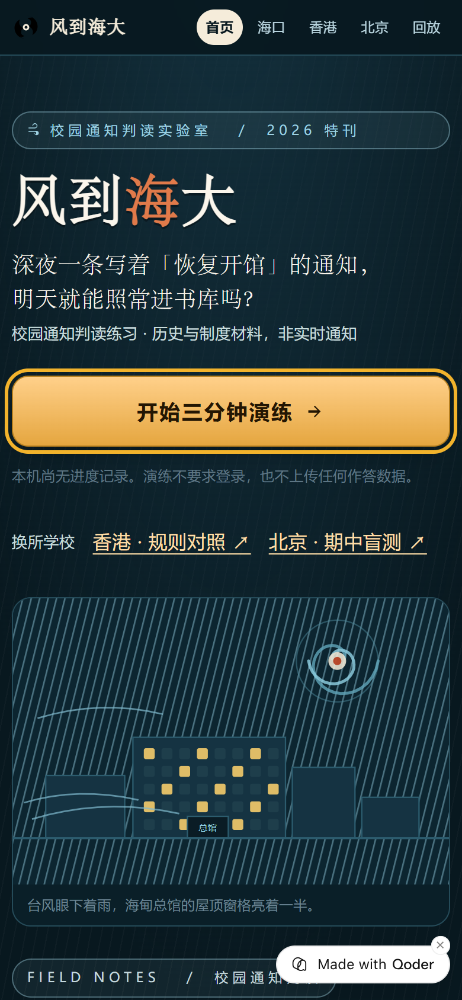

# 风到海大｜校园通知判读实验室

室友转来一条“恢复开馆”的通知，明天就能进书库吗？

**[直接试玩 ↗](https://campus-notice-lab-qy6hac0dpwr.qoder.zone/)** · [写一条试玩反馈](https://github.com/yuanwenhao468-jpg/fengdao-haida-playtest/issues/new?template=playtest.yml)

这是一个面向大学生的三分钟网页演练，参加 2026 Qoder 高校创造力大赛 Hack4Good 赛道。你可以从三所学校里任选一关，不用注册，也不用先看题解。

| 选一关 | 你会遇到什么 |
| --- | --- |
| 海口 · 海南大学 | 同一个约自习的问题，早上和深夜拿到的通知不同。 |
| 香港 · 香港中文大学 | 换一种天气警告，看看图书馆和研习设施的规则。 |
| 北京 · 北京大学 | 室友把期中复习的约定推迟了一天，还能沿用手上的通知吗？ |

### 帮我们试一次

用自己的手机或电脑打开作品，任选一关。玩完后，最想听的是：**你第一次怎么判断？页面上的哪句话或哪个操作让你犹豫了？** 没有卡住也欢迎告诉我们。遇到显示问题的话，附上浏览器和大致屏幕大小就很有帮助。

试玩不需要 GitHub 账号；通过 Issues 留言需要登录，内容会公开。请勿填写姓名、学号、联系方式或上传带有个人信息的截图。题目选项和答案请放在反馈正文，别写进标题，给下一位同学留个悬念。

作品使用学校公开材料。海口是历史演练，香港是制度模拟，北京是基于公告的练习；不提供实时开放状态。这里用于招募试玩和收集反馈。
